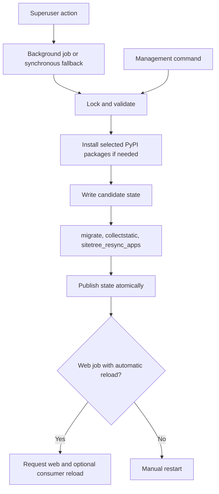

# Plugin internals

This Django app maintains a desired plugin configuration separately from the configuration
loaded by each running process. See the [main README](../README.md) for installation and use.

## Modules

| Path | Responsibility |
|---|---|
| [`manager.py`](manager.py) | Catalog, persistent state, locking, package installation and `configure()` |
| [`jobs.py`](jobs.py) | Background preparation, progress and interrupted-job detection |
| [`reload.py`](reload.py) | Candidate preparation, web reload and consumer heartbeat |
| [`windows_locks.py`](windows_locks.py) | Windows locks and handle inheritance for child processes |
| [`apps.py`](apps.py), [`sitetrees.py`](sitetrees.py) | App startup, superuser-only menu and consumer watcher |
| [`urls.py`](urls.py), [`views.py`](views.py) | Superuser page, actions, status and PyPI version checks |
| [`templates/plugins/index.html`](templates/plugins/index.html) | Page, status polling and browser-side controls |
| [`management/`](management/README.md) | Synchronous Django management command |
| [`tests/`](tests/README.md) | BDD features and Python steps |

## Change lifecycle

The CLI follows the same preparation path synchronously and always requires a manual
restart. In the web UI, status distinguishes the desired state from the state loaded by
the responding worker. With Huey enabled, confirmation also requires a fresh consumer
heartbeat for that state. It does not confirm that every web worker has restarted or
that individual Huey tasks have run.

`configure()` runs during Django settings initialization, before plugin-specific
settings. It loads the published state, or the temporary candidate when invoked by a
preparation subprocess, and updates `G3WADMIN_LOCAL_MORE_APPS`. Apps without a saved
decision retain their original configuration.

## Persistent state

All paths below are relative to `G3W_PLUGINS_DIR` (default
`/shared-volume/.g3w_plugins` in Docker):

| Path | Purpose |
|---|---|
| `state.json` | Desired enabled/disabled decisions and selected package directory |
| `site-<uuid>/` | Isolated installation of selected PyPI plugins and dependencies |
| `.state-*` | Temporary candidate used during preparation |
| `job.json` | Latest background operation, phase and result |
| `consumer-heartbeat.json`, `reload-request.json` | Consumer reload coordination |
| `.lock`, `.job.lock`, `.job-status.lock` | POSIX process locks; Windows uses named locks instead |

State publication uses an atomic replacement after successful preparation. Failed or
interrupted preparation can still have changed the database, static files or menus;
check logs and state before retrying. Old package directories remain available to
running workers. Back up the state directory and database before changes, and remove old
directories only after stopping all processes that use them.

Installation constrains dependencies already in the G3W environment; conflicts fail
rather than upgrade that environment. An update installs the requested newer stable
release and pins other managed plugins to their installed versions. PyPI checks are
cached for five minutes per web worker; a displayed release can still be incompatible.
The installed version shown is from the current worker and changes after reload.

## Deployment constraints

- Protect the state directory and package sources from untrusted writes. Enabling a
  catalogued package also installs its dependencies and executes third-party code.
- Web and consumer processes need the same state and installed packages, Python
  platform and compatible G3W image. A dependency conflict after an image change
  stops startup. To rebuild without starting Django, run
  `python -c "from g3w_plugins.manager import change; change('g3w-admin-panoramax', True)"`
  in the new runtime, naming an enabled external plugin and setting `G3W_PLUGINS_DIR`.
- GUI preparation runs in a separate process on POSIX and Windows; one GUI change
  runs at a time. Windows processes using the same state directory must share one
  host and resolved path, and must not share it with Linux. Stop all web and CLI
  processes once when updating to this locking scheme.
- Automatic reload requires Linux pidfds, Gunicorn or Granian, one web service
  instance and at most one Huey consumer. Reload an existing web process once
  after updating the manager. If Huey is enabled, restart the consumer once to
  start its watcher and use the current heartbeat format.
- If reload fails, retry from the page or restart web and consumer manually.
  Huey waits for running tasks before restarting. The page can follow a changed
  manager URL if the frontend changes.
- Confirmed success messages disappear on a browser-tab refresh; pending operations
  and errors remain visible. Without JavaScript, refresh to check progress.
